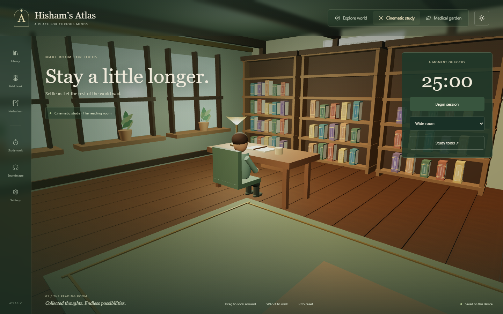
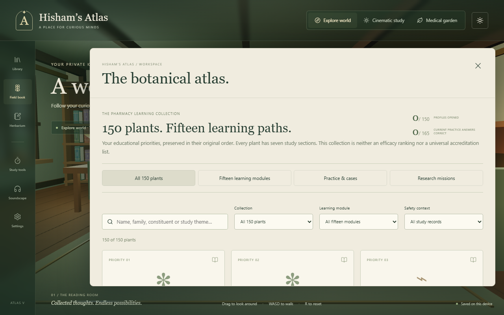
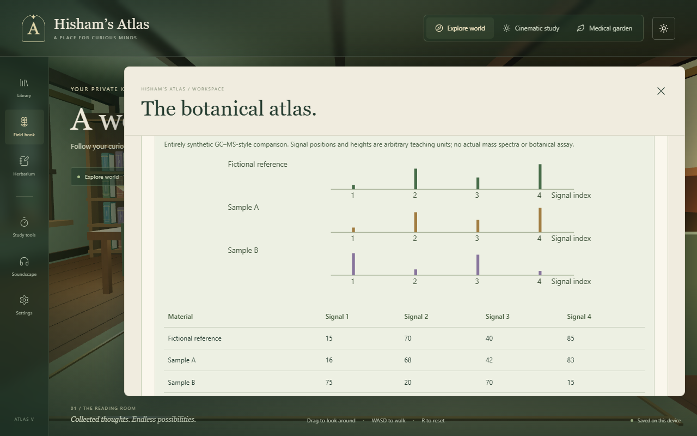

# Hisham’s Atlas

A local-first botanical learning app built with React, TypeScript and Three.js: explore a reading room and garden, study medicinal-plant profiles, investigate research missions and keep a personal library and notebook.



## Current version: 5.3

- 150 introductory plant profiles in fifteen learning modules.
- 165 saved practice questions and five interactive research missions with fifteen additional decisions.
- Seven study sections per plant, source-scope notes, research notes, literature links and virtual recognition records.
- Eight cultivation beds, local PDF reading/annotations, focus tools and local audio support.
- Browser-local IndexedDB storage and JSON backup/restore; no account or backend.

The separate PHY TOLAB institute module has a [fifteen-quest developer specification](docs/gameplay-specification/GAMEPLAY-SPECIFICATION.md). Its Q01/Q08/Q11 prototype and institute gameplay are planned, not implemented in this release.



## Run locally

Requires Node.js 22.12 or newer (previously tested with Node 24).

```sh
npm ci
npm run dev
```

Open the local address printed by Vite. Build and serve production assets with:

```sh
npm run build
node serve.mjs
```

The production server defaults to http://127.0.0.1:4173/. `npm run build` generates `dist/`; build output and installed dependencies are excluded from this source repository. Keep the server running while using the app. On Windows, `Start Atlas.cmd` can launch the production app after building. Serve over HTTP rather than opening `index.html` directly.

Browser data belongs to its browser profile and origin. Reuse the same address to retain local progress, and export a backup before changing browser or origin. Personal imported books/audio and saved browser data are not included in this repository. The fifty starter library entries are title metadata, not book downloads.

## Using the app

Drag to look, use WASD/arrows to move, and open **Field book** for profiles, learning modules, practice and research missions. The collection filter separates Essential 50, Next 50 and Tier 3. **Library** supports local imports; **Study tools** provides focus/task features. The original eight garden beds support a simplified accelerated cultivation simulation.

## Checks

```sh
npm test
npm run build
```

For browser tests, start the development server on port 5175:

```sh
npm run dev -- --port 5175 --strictPort
npm run test:e2e
```

The supplied Playwright configuration defaults to Microsoft Edge at its Windows installation path. Set `ATLAS_BROWSER` to an installed Chromium-compatible executable and `ATLAS_BASE_URL` to a different local server address when needed. The standalone production check is `node tests/production-smoke.mjs`; it temporarily uses port 4176. The previous release passed 26 unit checks, eight browser journeys and production smoke checks; see [verification details](docs/VERIFICATION-5.3.md). Generated reports, screenshots and test backups are intentionally excluded from the source package.

Regenerate the machine-readable curriculum with `npm run export:curriculum`. The gameplay-specification package has its own dependency-free Python checks: `python docs/gameplay-specification/validate-package.py`.

## Scientific scope

Profiles are introductory learning scaffolds with explicit review gaps, not completed clinical or pharmacopoeial monographs. Provisional metadata, microscopy, some mechanisms and several source appraisals require specialist review. Hazardous plant records teach recognition and scientific history without practical preparation or administration. Mission datasets are clearly labeled synthetic teaching material.

The twelve plant packets in the institute specification are review candidates, with zero claimed expert approvals. Its transfer examples and instructor keys are openly included for development; create a separate controlled unseen assessment bank before conducting educational validation.



## Project layout

| Path | Contents |
|---|---|
| `src/` | App, 3D world, curriculum, missions, reader and storage |
| `public/` | Exported curriculum and bundled PDF support assets |
| `scripts/` | Reproducible curriculum export |
| `tests/` | Model, curriculum and browser checks with synthetic fixtures |
| `docs/` | Science/content scope, sources, verification and third-party licenses |
| `docs/gameplay-specification/` | PHY TOLAB fifteen-quest blueprint, schemas and instructor keys |

## License and credits

The existing [MIT license](LICENSE) covers newly created application source. Third-party packages and supplied/imported material retain their own terms. See [asset provenance](docs/ASSETS.md) and `docs/licenses/`. Clinical references are external sources, not endorsements of this project.
